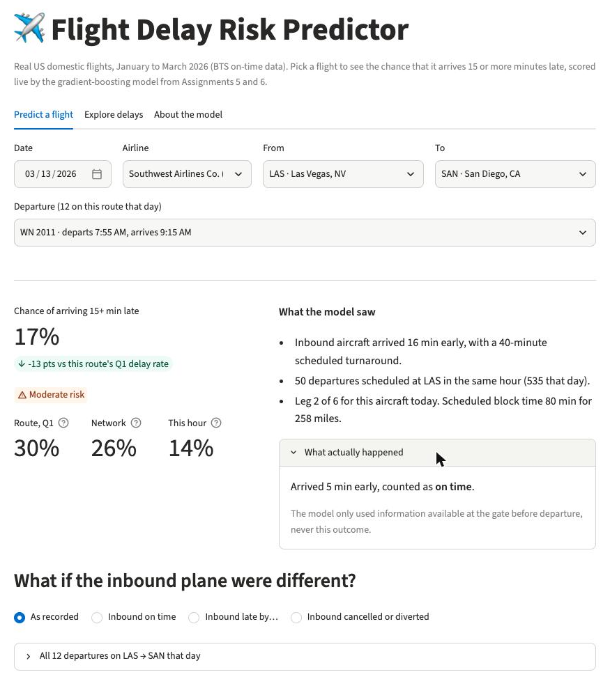
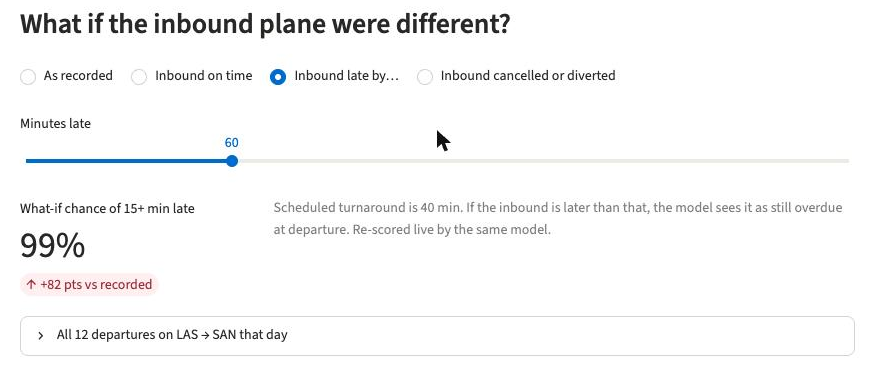
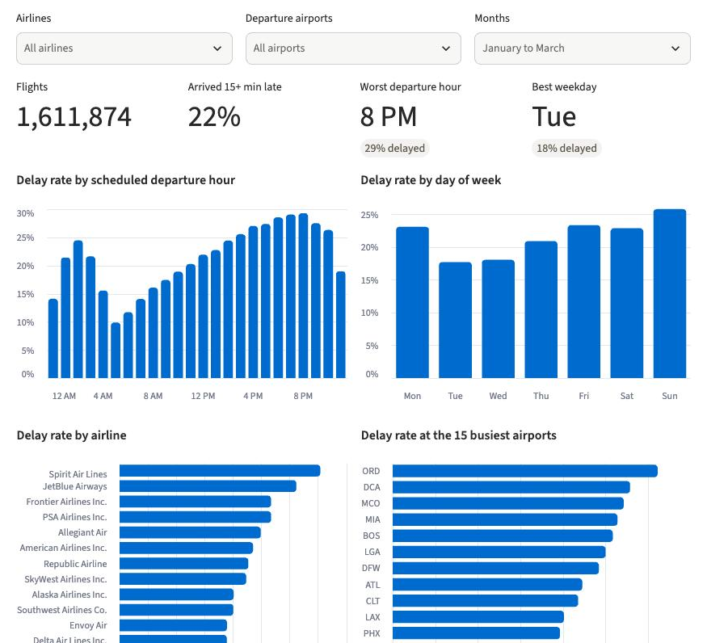

# Assignment 8 Data Product: Flight Delay Risk Predictor – User Guide
# Matthew Koziol
# IDC 4290 – Fall 2026

## How AI tools were used

I used Claude Code (Opus 5.5) as a coding assistant for this project. I described the assignment to it and worked through the design in conversation, including turning my assignment 5 and 6 flight delay model into the product instead of starting over, choosing a hosted Streamlit app over a REST API or Gradio so it could be opened from a link, using the gradient boosting model because the random forest file was too large for free hosting, looking up real scheduled flights so the model gets the same 28 inputs it was trained on, the inbound aircraft what-if control, the risk label cutoffs, and the dashboard charts. Claude helped write the app, the data preparation script, and the 32 unit tests, and took the screenshots in this guide from the running app. I ran the tests and the app myself, deployed it on Streamlit Community Cloud, checked every tab, and went back through this guide to make sure each number matched what the app shows.

## 1. What the tool does

**Link:** {{APP_URL}}

The Flight Delay Risk Predictor is a web app that answers one question for a real US domestic flight: what is the chance that it arrives 15 or more minutes late? The user picks a date, an airline, a departure airport, a destination, and one of the scheduled departures on that route, and the app runs the gradient boosting model from assignments 5 and 6 on that flight in real time. It also has a dashboard for exploring delay patterns across all 1,611,874 flights and a page that explains how good the model is and where its limits are.

The app covers every completed domestic flight from January 1 to March 31, 2026, from the Bureau of Transportation Statistics on-time performance data. Nothing needs to be installed to use it. The source code is public at https://github.com/mattkoziol/flight-delay-risk.

## 2. Opening the app

- **Step 1:** Open the link above in any browser (Chrome, Safari, Firefox, or Edge, on a computer or phone).
- **Step 2:** If the page says the app is asleep, click the button to wake it up. Free Streamlit apps go to sleep when nobody has used them for a while, and waking up takes about 30 to 60 seconds.
- **Step 3:** The first load shows "Loading 1.6 million flights and the model…" for a few seconds. After that, every change is instant.

The app has three tabs across the top: **Predict a flight**, **Explore delays**, and **About the model**.

## 3. Predicting a flight



- **Date:** Pick any day from January 1 to March 31, 2026. The default is Friday, March 13.
- **Airline:** Only airlines flying that day are listed, busiest first.
- **From:** Only airports that airline flew out of that day are listed, busiest first.
- **To:** Only destinations that airline flew to from that airport that day are listed.
- **Departure:** Every scheduled departure on that route that day, with the flight number and scheduled departure and arrival times. The label shows how many there were.

Each list is filtered by the choice before it, so it is not possible to pick a flight that did not exist. The result appears as soon as a departure is chosen:

- **Chance of arriving 15+ min late:** The model's probability for this flight, with how many percentage points it sits above or below the route's actual delay rate for January to March. A green, downward arrow means less risky than usual for the route.
- **Risk label:** Low (under 15%), Moderate (15% to 35%), or High (35% or more). The average flight in the data has a 22% delay rate.
- **Route, Q1 / Network / This hour:** Three reference numbers: the route's actual delay rate, the average model risk across every flight that day, and the actual delay rate for all flights leaving in the same hour. Hovering over the question marks explains each one.
- **What the model saw:** A plain summary of the inputs that matter most: how late the inbound aircraft was, how busy the departure airport was that hour, and where this flight falls in the aircraft's day.
- **What actually happened:** Click to open. Because the data is historical, the app can show the real arrival delay next to the prediction. The model never sees this.

**Worked example:** With the defaults, Southwest flight 2011 from Las Vegas (LAS) to San Diego (SAN), departing at 7:55 AM on March 13, has a 17% chance of arriving 15 or more minutes late, which is a Moderate risk and 13 points below the route's 30% delay rate for the quarter. The inbound aircraft arrived 16 minutes early with a 40-minute scheduled turnaround, it was the second of six legs for that aircraft that day, and 50 departures were scheduled at LAS in the same hour. The flight actually arrived 5 minutes early.

## 4. The inbound aircraft what-if



The strongest single input to the model is whether the aircraft that will operate the flight has already arrived, and how late it was. The what-if row lets the user change only that and see the model re-score the same flight live:

- **As recorded:** The real situation, the same as the main result.
- **Inbound on time:** The aircraft arrived exactly on schedule.
- **Inbound late by…:** A slider from 0 to 240 minutes. If the delay is longer than the scheduled turnaround, the aircraft is treated as still not at the gate when the flight was supposed to leave, which is how it was coded in assignment 5.
- **Inbound cancelled or diverted:** The aircraft's previous flight never arrived normally.

For the worked example, the recorded 17% becomes 24% if the inbound is exactly on time (it really arrived 16 minutes early), 44% at 15 minutes late, 84% at 30 minutes late, 99% at 60 minutes late, and 69% if the inbound flight was cancelled or diverted. With only a 40-minute turnaround, there is very little room to absorb a late inbound. If a flight is the aircraft's first of the day, there is no inbound aircraft and the what-if is turned off with a short explanation.

**All departures on the route that day:** The expander under the what-if lists every departure on the chosen route that day with its model risk as a bar and its actual arrival delay, so a traveler could compare options.

## 5. Exploring delays



- **Filters:** Airlines, departure airports, and months can each be narrowed to one or more choices. Leaving a filter empty means all of them.
- **Summary numbers:** The number of flights in the selection, the share that arrived 15 or more minutes late, the worst scheduled departure hour, and the best day of the week.
- **Charts:** Delay rate by departure hour, by day of the week, by airline, and at the 15 busiest departure airports in the selection. Hovering over a bar shows the exact rate and the number of flights. The menu in the corner of each chart can save it as an image.
- **Table view:** The airline numbers as a sortable table.

Across all flights, the delay rate builds through the day from 10% at 5 AM to 29% at 8 PM, Tuesday is the best day (18%) and Sunday the worst, and Spirit, JetBlue, and Frontier have the highest delay rates.

## 6. About the model and how it is connected

The **About the model** tab shows the model's results on March 2026, a month it never saw during training: ROC AUC 0.817, PR AUC 0.708, Brier score 0.121, and expected calibration error 0.025. For comparison, logistic regression scored 0.783 and the random forest 0.819 on the same test set in assignment 6.

- **Model:** A scikit-learn histogram gradient boosting classifier trained in assignment 6 on 838,585 flights from January 1 to February 18, 2026. The saved model file (2.2 MB) is loaded by the app exactly as it was saved.
- **Data:** A preparation script (prep.py) takes the assignment 5 feature table and joins it with the flight numbers, times, and outcomes, then stores it as one 61 MB file with all 28 model inputs for every flight. A test checks that the app's live predictions match the assignment 6 predictions to within 0.000001 on 20,000 random flights.
- **Prediction:** Choosing a flight looks up its row and runs the model on it, which takes about 5 milliseconds. The what-if control changes only the two inbound aircraft inputs and runs the model again.

## 7. Scalability

- **Loaded once, shared by everyone:** The flight table and the model are loaded into memory once when the app starts and are shared by every visitor, so a new visitor or a new choice does not reload anything. The running app uses about 630 MB of memory.
- **Fast lookups:** The table is sorted by date and the start and end of each day are found in advance, so picking a date only touches that day's 10,000 to 21,000 flights instead of all 1.6 million.
- **Precomputed dashboard:** The Explore tab reads a small summary table (0.4 MB of counts by month, airline, airport, weekday, and hour) instead of the full data, so filtering is instant.
- **Growing it:** The prediction logic is in its own file (core.py), separate from the web pages, so the same functions could be served as a REST API or used to score a whole day's schedule in one batch. Covering new months would only need the BTS download and the assignment 5 feature script to be run on the new data, then prep.py.

## 8. Limits

- **January to March 2026 only:** The model's inputs come from the real schedule, such as how busy the airport was and how late the inbound aircraft was. A future date does not have those yet, so it cannot be scored.
- **Cancelled and diverted flights are not included:** The model predicts arrival delay for flights that operated.
- **At the gate, not at booking:** The predictions use what is known when the flight is about to leave. A prediction made when the ticket is bought would be much weaker (ROC AUC about 0.68 in assignment 5).
- **A probability, not a promise:** The probabilities are well calibrated on average, but any single flight can still go either way.

## 9. Running it on your own computer (backup)

If the link is ever unavailable, the app runs locally with Python 3.12:

```
git clone https://github.com/mattkoziol/flight-delay-risk.git
cd flight-delay-risk
pip install -r requirements.txt
python -m streamlit run streamlit_app.py
```

Then open http://localhost:8501 in a browser. The tests run with python -m pytest.
